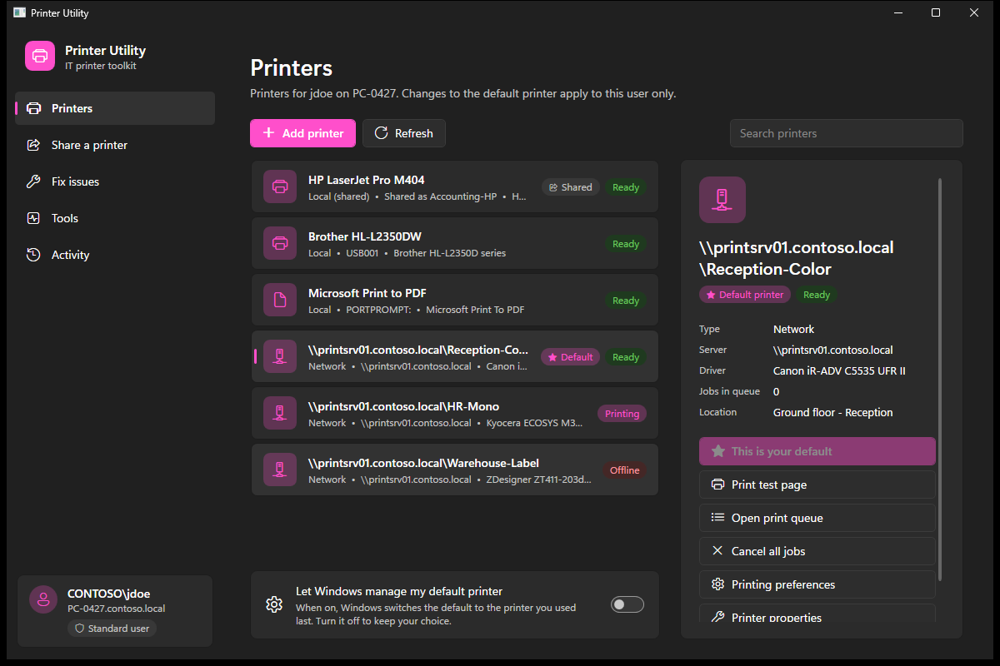
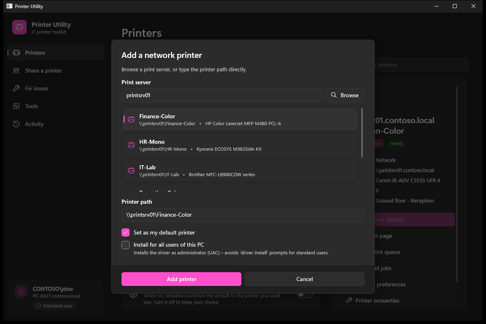
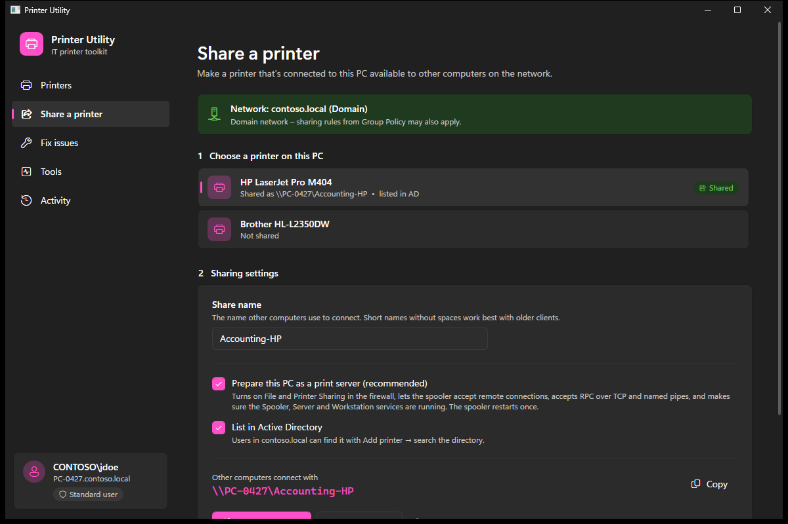
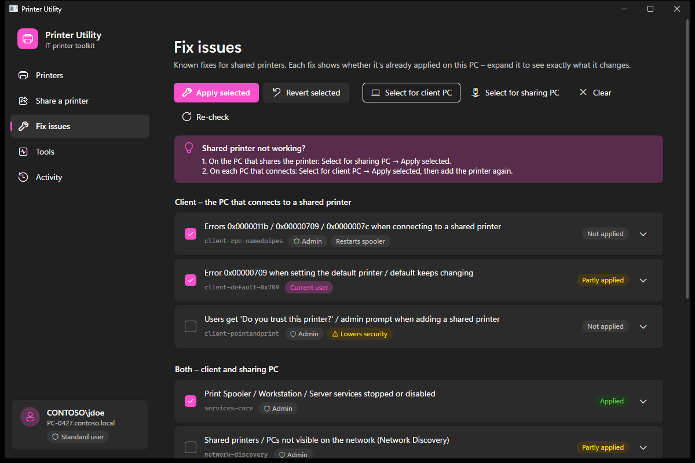
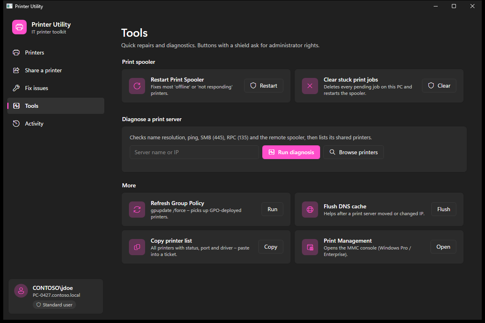
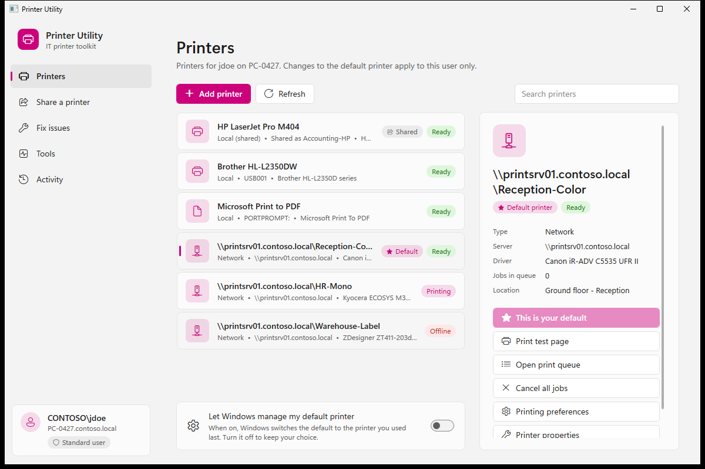
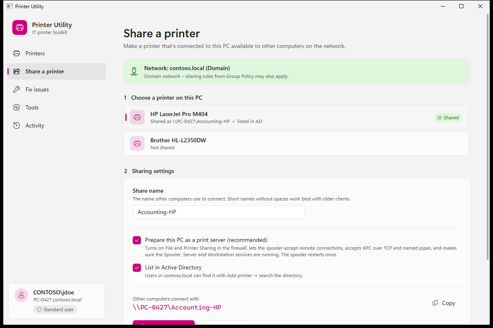

# Printer Utility

**An all-in-one printer tool for Windows IT admins.** Set default printers, connect network printers,
share a printer from a PC, and fix the usual printer-sharing errors (0x0000011b, 0x00000709,
0x0000007c, driver-install prompts). It works on PCs where Control Panel is blocked by Group Policy.

### [⬇ Download PrinterUtility.exe](https://github.com/SpeedGamer21/printer-utility/releases/latest/download/PrinterUtility.exe)

Single file, about 190 KB, nothing to install. Runs on Windows 10/11 and Server 2016+.
[All releases](https://github.com/SpeedGamer21/printer-utility/releases)



---

## Contents

- [Why this exists](#why-this-exists)
- [Features](#features)
- [Screenshots](#screenshots)
- [Requirements](#requirements)
- [Getting the app](#getting-the-app)
- [How to use it](#how-to-use-it)
  - [1. Set a user's default printer](#1-set-a-users-default-printer)
  - [2. Add a network printer](#2-add-a-network-printer)
  - [3. Share a printer from a PC](#3-share-a-printer-from-a-pc)
  - [4. Fix printer-sharing errors](#4-fix-printer-sharing-errors)
  - [5. Tools](#5-tools)
  - [6. Activity log](#6-activity-log)
- [How administrator rights work](#how-administrator-rights-work)
- [Fix reference](#fix-reference)
- [Command line](#command-line)
- [Troubleshooting](#troubleshooting)
- [Demo mode](#demo-mode)
- [Building from source](#building-from-source)
- [Project structure](#project-structure)

---

## Why this exists

Many organisations block Control Panel and the Settings app with the GPO
*User Configuration → Administrative Templates → Control Panel → Prohibit access to Control Panel
and PC settings* (`NoControlPanel`). That also blocks the usual ways of changing a default printer,
adding a shared printer, or turning on printer sharing.

Printer Utility calls the Windows print spooler API (`winspool.drv`) and the print UI engine
(`printui.dll`) directly, so it **doesn't need Control Panel or Settings**. It's a single exe you
can run from a USB stick or a network share without installing anything.

## Features

| Area | What you can do |
|---|---|
| **Printers** | List every printer with its status, jobs, port, server and driver; search; set the default (double-click); print a test page; open the queue; cancel all jobs; open preferences or properties; remove |
| **Add printer** | Browse a print server's shared printers, or type `\\server\printer`. Add it for the current user, or **for all users of the PC** (installs the driver as admin) |
| **Share a printer** | Share a local printer with any share name, optionally list it in Active Directory, and set the PC up as a print server in the same step (firewall, spooler, RPC, services). Warns when the network is set to *Public* |
| **Fix issues** | 10 known fixes for client and server problems. Each one shows whether it's already applied on this PC, and explains exactly what it changes. Registry fixes can be undone |
| **Tools** | Restart the spooler, clear stuck jobs, save printer credentials in Credential Manager, diagnose a print server (DNS, ping, SMB 445, RPC 135, remote spooler), `gpupdate /force`, flush DNS, copy the printer list, Print Management |
| **Activity** | Full log of everything done in the session, including output from the elevated helper |
| **Command line** | Every main action can be scripted (`--set-default`, `--add`, `--fix`, `--share`, …) |
| **UI** | Windows 11 style, follows the Windows **light/dark mode and accent color** |

## Screenshots

| | |
|---|---|
|  |  |
| **Add printer** – browse a print server and choose a printer | **Share a printer** – share name, AD listing, print-server setup |
|  |  |
| **Fix issues** – status of each fix, with details for each | **Tools** – spooler, diagnostics, Group Policy, DNS |
|  |  |
| **Light mode** – follows the Windows app theme | Accent color comes from Windows |

> The screenshots use the built-in [demo mode](#demo-mode) (fictitious *Contoso* printers and
> users), so they don't contain any real host or user names.

## Requirements

- Windows 10 (1903 or later) or Windows 11, Windows Server 2016 or later
- .NET Framework 4.8, which comes with Windows (nothing to install)
- Administrator credentials **only** for admin actions (sharing, machine-wide fixes, spooler). Setting the
  default printer and connecting printers for the current user work as a standard user.

## Getting the app

**Option A: download (recommended).**
[**PrinterUtility.exe** (latest release)](https://github.com/SpeedGamer21/printer-utility/releases/latest/download/PrinterUtility.exe).
Each [release](https://github.com/SpeedGamer21/printer-utility/releases) lists the file's SHA-256 so
you can verify the download:

```powershell
Get-FileHash .\PrinterUtility.exe -Algorithm SHA256
```

> The exe isn't code-signed, so Windows SmartScreen may show *"Windows protected your PC"* the first
> time. Click **More info → Run anyway**, or right-click the file → **Properties → Unblock**. To
> deploy it widely, sign it with your organisation's code-signing certificate.

**Option B: build it** (see [Building from source](#building-from-source)):

```powershell
dotnet build -c Release
# output: bin\Release\net48\PrinterUtility.exe
```

Copy **only `PrinterUtility.exe`** to a USB stick, `\\fileserver\it-tools\`, or wherever you want it.
It runs on its own.

> **AppLocker / SRP:** if you restrict executables, allow `PrinterUtility.exe` for your IT group by
> path, publisher or hash.

---

## How to use it

Start `PrinterUtility.exe` **as the logged-on user**: double-click it, don't use *Run as
administrator*. The sidebar on the left switches between pages. The card at the bottom shows who
the tool is running as.

### 1. Set a user's default printer

1. Open **Printers**.
2. **Double-click** the printer, or select it and click **Set as default** in the right-hand panel.
3. A notification confirms it, and the printer gets a ★ **Default** label.

If the default keeps switching back, turn **off** *Let Windows manage my default printer* (the toggle
at the bottom of the page). Setting a default turns it off automatically.

> **Why run as the user?** The default printer is stored per user (HKCU). If you start the tool with
> *Run as administrator* using your admin account, you change the **admin's** default instead. The
> sidebar card shows *Running as administrator* when that's the case.

### 2. Add a network printer

1. **Printers → Add printer**.
2. Type the print server (for example `printsrv01`) and click **Browse**. The server's shared printers
   are listed. Pick one, or type the full path `\\server\printer` yourself.
3. Choose:
   - **Set as my default printer**: makes it the default right away.
   - **Install for all users of this PC**: adds a *per-machine* connection with admin rights (UAC).
     The driver is installed once by an admin, so standard users don't get the *"Do you trust this
     printer?"* / driver-install prompt. Every user who signs in gets the printer.
   - **Connect with a different user name and password**: for a server outside your domain, or one
     that rejects your account. The user name and password are saved in **Credential Manager**
     (*Windows Credentials*) for you and that server, then used for Browse and Add. A plain `user` is
     saved as `SERVER\user`.
4. Click **Add printer**.

If it fails, the notification tells you why and links straight to the matching fix (for example
**Fix it** for 0x0000011b). If the server rejects your account (1326, 1219, …), a credentials dialog
opens. After you save the credentials, the printer is added again automatically.

### 3. Share a printer from a PC

Use this on the PC that has the printer attached (USB or IP) and should share it with others.

1. Open **Share a printer**.
2. Check the network banner at the top:
   - green **Domain / Private**: fine.
   - yellow **Public**: Windows blocks sharing. Click **Switch to Private** (only on trusted networks).
3. **Choose a printer.** Only physical printers are listed; *Print to PDF* and similar are hidden.
4. **Share name.** A name is suggested. Keep it short and without spaces for older clients.
5. Leave **Prepare this PC as a print server** ticked. In the same UAC prompt it:
   - enables the *File and Printer Sharing* firewall rules (works on any Windows language)
   - allows the spooler to accept client connections (PrintNightmare mitigation)
   - accepts RPC over TCP **and** named pipes (Windows 10 and 11 clients)
   - makes sure *Spooler*, *Server* and *Workstation* services are automatic and running
6. Optionally tick **List in Active Directory** (domain-joined PCs only).
7. Click **Share printer** and approve the UAC prompt.
8. Give users the path shown under *Other computers connect with*, for example
   `\\PC-0427\Accounting-HP` (use the **Copy** button).

The **Shared from this PC** list at the bottom shows what's shared, with buttons to copy the path or
edit sharing. To stop sharing, select the printer and click **Stop sharing**.

### 4. Fix printer-sharing errors

Open **Fix issues**. Each card shows a status label (**Applied**, **Partly applied** or
**Not applied**). Click **⌄** to see exactly which registry values, services or firewall rules it
changes.

**Typical "can't connect to the shared printer" case:**

| Where | Do this |
|---|---|
| **On the PC/server that shares the printer** | **Select for sharing PC → Apply selected** |
| **On every PC that connects to it** | **Select for client PC → Apply selected**, then add the printer again |

Labels on each fix:

- 🛡 **Admin**: needs a UAC prompt. **Current user** fixes run without admin rights.
- ⚠ **Lowers security**: you get an extra confirmation that explains the risk.
- **Restarts spooler**: the spooler restarts once after the fixes are applied.

To undo, select the fixes and click **Revert selected**. Registry-based fixes and firewall changes
can be reverted.

> If one of your GPOs manages the same policy keys
> (`HKLM\SOFTWARE\Policies\Microsoft\Windows NT\Printers\…`), the GPO overwrites these values at the
> next policy refresh. In that case, change the GPO itself.

### 5. Tools

| Tool | When to use it |
|---|---|
| **Restart Print Spooler** 🛡 | Printers show *Offline*, jobs don't move, the spooler hangs |
| **Clear stuck print jobs** 🛡 | A job is stuck and can't be deleted. Stops the spooler, empties `spool\PRINTERS`, starts it again |
| **Credential Manager** | Lists the current user's saved Windows credentials for servers. **Add credential** saves a print server's user name and password in Credential Manager (which is blocked along with Control Panel), closes the stale connection (error 1219) and tests the logon. 🗑 removes a credential. Use it when the credential prompt rejects every password, which is common on domain-joined PCs |
| **Diagnose a print server** | Users can't connect. Shows ✔/✖ for DNS, ping, SMB 445, RPC 135 and the remote spooler, and lists the server's shared printers |
| **Refresh Group Policy** | GPO-deployed printers haven't arrived yet |
| **Flush DNS cache** | A print server was moved or changed IP |
| **Copy printer list** | Paste every printer, its status, port, driver and share path into a ticket |
| **Print Management** | Opens `printmanagement.msc` (Pro/Enterprise) |

### 6. Activity log

**Activity** lists everything the tool did in this session, with timestamps and ✔ / ⚠ / ✖ icons,
including the output of the elevated helper. Unread errors show as a red count in the sidebar. Use
**Copy all** to paste the log into a ticket.

---

## How administrator rights work

```
PrinterUtility.exe (runs as the user)                 PrinterUtility.exe --elevated (admin)
 ├─ default printer, per-user connections, HKCU fixes   ├─ HKLM fixes, firewall, services
 └─ admin action needed ─── UAC prompt ───────────────► ├─ share/unshare, all-users printers
                        ◄── log is passed back ──────── └─ spooler restart / clear
```

- The main window always runs as the logged-on user, so per-user settings land in the right profile.
- Admin-only actions start a short-lived, hidden, elevated copy of the same exe. You can type admin
  credentials into the UAC prompt on the user's session. Its log appears in the main window.
- Per-user fixes (marked **Current user**) never go through the elevated copy.

## Fix reference

| Id | Side | Problem | What it changes |
|---|---|---|---|
| `client-rpc-namedpipes` | Client | 0x0000011b / 0x00000709 / 0x0000007c on Windows 11 22H2, 23H2, 24H2 | `HKLM\…\Printers\RPC\RpcUseNamedPipeProtocol = 1` |
| `client-domain-rpc-auth` ⚠ | Client | AD-joined PC: the credential prompt rejects every password for a printer shared from a workgroup PC or another domain | `RpcUseNamedPipeProtocol = 1`, `RpcAuthentication = 2`. Revert removes only `RpcAuthentication`. Use it together with **Tools → Credential Manager** |
| `client-default-0x709` | Client (user) | 0x00000709 when setting a default; default keeps changing | `HKCU\…\Windows\LegacyDefaultPrinterMode = 1`, removes a stale `Device` value |
| `client-pointandprint` ⚠ | Client | Driver-install / *trust this printer* prompt for standard users | Point and Print restrictions limited to **your** trusted server list |
| `services-core` | Both | Spooler / Workstation / Server stopped or disabled | Sets them to Automatic and starts them |
| `network-discovery` | Both | PCs/printers not visible when browsing | FDResPub, fdPHost, SSDPSRV, upnphost + *Network Discovery* firewall group |
| `server-firewall` | Server | Clients can't reach the shared printer | *File and Printer Sharing* firewall group (Domain/Private) |
| `server-remote-endpoint` | Server | Spooler refuses client connections | `RegisterSpoolerRemoteRpcEndPoint = 1` |
| `server-rpc-listener` | Server | Mixed Windows 10/11 clients fail | `RpcProtocols = 7`, `ForceKerberosForRpc = 0` |
| `server-011b` ⚠ | Server | Old 0x0000011b workaround | `HKLM\SYSTEM\…\Control\Print\RpcAuthnLevelPrivacyEnabled = 0` |

⚠ = lowers a security hardening. Use only when needed, and prefer the non-⚠ fixes.

## Command line

Every main action can be scripted. Admin actions need an elevated prompt when run from the command
line.

```text
PrinterUtility.exe --list                                   list printers (* = default)
PrinterUtility.exe --set-default "\\server\printer"         set the default for the current user
PrinterUtility.exe --add \\server\printer [--default]       connect a printer for the current user
PrinterUtility.exe --remove \\server\printer
PrinterUtility.exe --add-all-users \\server\printer         per-machine connection (admin)
PrinterUtility.exe --share "HP LaserJet" Accounting-HP --prepare [--publish]     (admin)
PrinterUtility.exe --unshare "HP LaserJet"                  (admin)
PrinterUtility.exe --save-credential pc-07 jdoe --password "..."   saves PC-07\jdoe for the current user
PrinterUtility.exe --list-credentials                       saved server credentials (current user)
PrinterUtility.exe --remove-credential pc-07
PrinterUtility.exe --list-fixes                             fixes and their status on this PC
PrinterUtility.exe --fix client-rpc-namedpipes,services-core
PrinterUtility.exe --fix client-pointandprint --param "srv01;srv01.contoso.local"
PrinterUtility.exe --revert client-rpc-namedpipes
PrinterUtility.exe --restart-spooler | --clear-spooler      (admin)
PrinterUtility.exe --help
```

Exit codes: `0` success, `1` an action failed, `2` invalid usage.

## Troubleshooting

| Symptom / error | Try |
|---|---|
| **0x0000011b** when adding a shared printer | Client: `client-rpc-namedpipes`. Server: *Select for sharing PC* |
| **0x00000709** when adding a printer | Same as above; also check the printer name/share |
| **0x00000709** when setting the default | `client-default-0x709` (no admin needed) |
| **0x0000007c** | `client-rpc-namedpipes` |
| Domain-joined PC: *Enter network credentials* rejects every user name and password, or 0x0000052e / 1326 / 1219 | **Tools → Credential Manager → Add credential** with `SHARINGPC\user` (an account that has a password). Then apply `client-domain-rpc-auth` and `client-rpc-namedpipes`. If the **sharing** PC is the domain-joined one, apply `server-rpc-listener` on it |
| *"Do you trust this printer?"*, access denied, 0x00000bcb | Add it with **Install for all users** (admin), or `client-pointandprint` |
| RPC server unavailable (1722) / network path not found (53) | **Tools → Diagnose**; on the sharing PC apply `server-firewall`, `server-remote-endpoint` |
| Sharing works on one network but not another | **Share a printer** banner: the network is probably *Public* |
| Printer *Offline*, jobs stuck | **Tools → Restart spooler**, then **Clear stuck jobs** |
| App doesn't start | Details are in `%TEMP%\PrinterUtility-crash.log` |

## Demo mode

```powershell
PrinterUtility.exe --demo          # follow the Windows theme
PrinterUtility.exe --demo light    # or: --demo dark
```

Shows fictitious sample data (Contoso printers, user `CONTOSO\jdoe`, PC `PC-0427`). Use it for
screenshots and training. **Demo mode never changes anything.** Every action only writes
`[demo] …` to the Activity log.

## Building from source

Requirements: the .NET SDK (6 or later), which can target .NET Framework 4.8.

```powershell
git clone <this repository>
cd printer-utility
dotnet build -c Release
```

The output is `bin\Release\net48\PrinterUtility.exe` (about 190 KB). Copying just that one file is
enough to deploy it.

## Project structure

```
PrinterUtility.csproj      WPF, .NET Framework 4.8, asInvoker manifest
app.manifest               runs as the user, Per-Monitor-V2 DPI
Themes/Styles.xaml         Windows 11 style controls (buttons, nav, toggles, cards, scrollbars)
src/
  Program.cs               entry point: GUI, command line, --elevated helper, --demo
  Native.cs                winspool.drv / dwmapi P/Invoke
  PrinterService.cs        list/default/add/remove/purge/share printers
  Fixes.cs                 the fix catalog (add new fixes here)
  ActionRunner.cs          string actions shared by GUI, CLI and elevated helper
  Elevation.cs             UAC helper process + log hand-back
  Credentials.cs           saved server credentials (CredWrite), session reset, logon test
  SystemTools.cs           spooler, services, firewall (COM), network profile, diagnostics
  Session.cs               current identity + demo data
  Logger.cs
  UI/                      MainWindow (shell), pages, view models, theme
docs/screenshots/          images used in this README
```

### Adding a new fix

Add an entry to `FixCatalog.Build()` in [`src/Fixes.cs`](src/Fixes.cs). Use a `RegistryFix` for
registry values (status check and revert come for free), or an `ActionFix` for code. The GUI, the
command line and the status display pick it up automatically.
